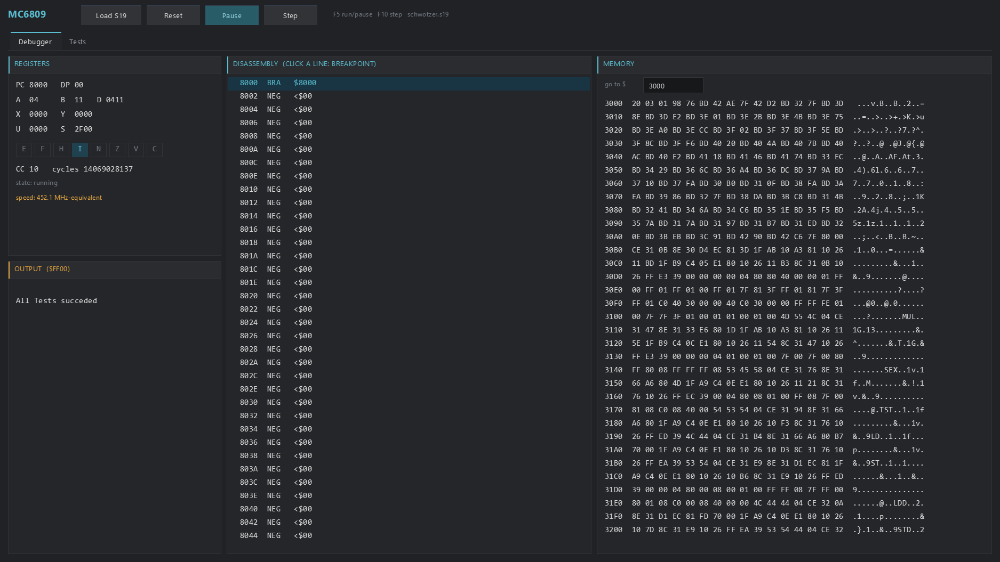

# MC6809 for the Raspberry Pi Pico series — PureMetal

A fast, cycle-counted **Motorola 6809 CPU core** for the Raspberry Pi Pico W
(RP2040) and the Pico 2 family (RP2350), written in
[PureMetal](https://forum.ajtaji.com). The interpreter runs from SRAM and
dispatches through 256-entry label tables with a computed jump at the end of
every handler — no procedure call per emulated instruction — and on the RP2350
its dispatch and branches are Cortex-M33 Thumb-2. Memory goes through 256-byte
page tables, so a machine can map RAM, ROM, write-protected and I/O pages (an
MMU such as the Tandy CoCo 3's GIME) without slowing plain RAM. The same core
also builds for Windows as a PureBasic program with a debugger window.

It is verified on silicon against 31,000 one-instruction cases with exact cycle
counts, interrupt and bus checks, and a full 6809 validation program.



## Features

- The **whole documented MC6809 instruction set**: pages 1, 2 (`$10`) and 3
  (`$11`), every addressing mode including indexed indirect, CC with the half
  carry, DAA, MUL, SEX, EXG/TFR, PSH/PUL, CWAI and SYNC, SWI/SWI2/SWI3.
- **IRQ, FIRQ and NMI** as machine-driven lines with correct E-flag stacking
  (entire state for IRQ/NMI/SWI, PC and CC for FIRQ), NMI disarmed until S is
  loaded, lines re-sampled after any I/O access or unmasking instruction.
- **Cycle counts** per instruction, indexed-mode extras and taken long branches
  included (`#CPU_TIMING = 1`, run windows in E cycles), or an untimed build
  that budgets instructions for the last bit of speed.
- **Paged memory with I/O hooks**: 256 read and 256 write page pointers;
  `CpuMapPages` / `CpuMapIo`; the machine supplies `CpuBusRead` / `CpuBusWrite`
  for I/O pages only. ROM pages discard writes.
- Undocumented opcodes stop the core loudly (`CpuStopped`, `CpuBadOpcode`);
  undocumented indexed postbytes and EXG/TFR codes behave as the silicon does.
- One generator (`tools/generate.py`) produces the RP2040, RP2350 and desktop
  cores from a single handler list.

## Supported boards

| Board | Chip | Core file | Verified on silicon |
|---|---|---|---|
| Raspberry Pi Pico W | RP2040 (Cortex-M0+, Thumb-1) at 200 MHz | `src/cpu6809.pico` | yes — all suites |
| Raspberry Pi Pico 2 W, Pimoroni Pico Plus 2 W, Adafruit Feather RP2350 | RP2350 (Cortex-M33, Thumb-2) at 150 MHz | `src/cpu6809.pico2` | yes — all suites (Pico 2 W and Feather RP2350) |
| Windows x64 | PureBasic 6.41 C back end | `desktop/cpu6809.pbi` | yes — all suites in the console and the window |

This repository is the CPU; it drives no display or sound itself. A machine
built on it puts the CPU on core 0 and its video and sound on core 1 — the
Tandy CoCo 3 emulator does exactly that.

## Performance

Each sample is exactly 1,000,000 emulated instructions (untimed build) or a
1,000,000-cycle budget (timed build), measured on the board with USB outside
the interval; memory goes through the page tables throughout.

| Mix | Pico W (RP2040, 200 MHz) | Pico 2 family (RP2350, 150 MHz, Thumb-2) |
|---|---:|---:|
| `DECB / BNE` loop | 3.67 M instr/s · 9.19 MHz-equiv. | 4.69 M instr/s · 11.55 MHz-equiv. |
| `ADDA # / EORA # / ASLA / LSRA / ADDD # / ANDCC # / BRA` | 1.93 M · 4.99 MHz | 1.98 M · 5.08 MHz |
| `LDA ,X+ / STA ,Y+ / DECB / BNE` copy | 2.29 M · 9.49 MHz | 2.46 M · 10.39 MHz |
| `BSR / PSHS / LDD 2,S / LEAX / PULS / RTS / BRA` | 1.29 M · 8.00 MHz | 1.29 M · 8.06 MHz |

"MHz-equivalent" is the 6809 E clock the timed build sustains. A CoCo 3 runs at
0.89 or 1.79 MHz, so the core has between 2.8 and 13 times the speed it needs.
On the RP2350 the Thumb-2 dispatch tail and branches made the register/branch
mix 45% faster than the same core's Thumb-1 tail (3.23 → 4.69 M instr/s).

On a PC the desktop core runs 645–1,053 MHz-equivalent (timed) and
157–251 M instr/s (untimed); see [desktop/README.md](desktop/README.md).

## Quick start: the demo firmware

1. Hold **BOOTSEL** while plugging the board into USB; a drive appears.
2. Copy `firmware/6809-picow.uf2` (Pico W) or `firmware/6809-pico2w.uf2`
   (Pico 2 family) onto it. The board restarts into the demo.
3. Open the board's USB serial port in any terminal (the baud rate does not
   matter). It prints a smoke test (`sum test A=55 PASS`) and then the four
   benchmark mixes above, once a second.

The demo is built only from this repository and contains no third-party code
or ROM.

## Using the core in a machine

```text
#CPU_TIMING = 1        ; 1: CpuRun's budget is E CYCLES and CpuCycles counts them
                       ; 0: the budget is INSTRUCTIONS (fastest, no cycle accounting)
#CPU_ASM_TAIL = 1      ; 1: assembly dispatch tail; 0: plain PureMetal computed Goto
XIncludeFile "src/cpu6809.pico"      ; RP2040 (src/cpu6809.pico2 on the RP2350)

Procedure.i CpuBusRead(addr.i)            ; the machine defines these two; they are
  ...                                     ; called only for pages mapped as I/O
EndProcedure
Procedure CpuBusWrite(addr.i, value.i)
  ...
EndProcedure
```

### Memory

The 64 KB address space is 256 pages of 256 bytes. Fill the tables only with:

| Call | Effect |
|---|---|
| `CpuMapPages(first, count, host, writable)` | Map `count` pages from page `first` onto host memory at address `host` (an SRAM array `@Ram(n)`, PSRAM, or flash for ROM). `writable = 0` makes them read-only. |
| `CpuMapIo(first, count)` | Route those pages to `CpuBusRead` / `CpuBusWrite`. |

A plain RAM read is one table load, a test and a byte load. A 16-bit access
inside one page uses one pointer; one that straddles pages goes byte by byte,
so a word may span RAM and I/O correctly. For an 8 KB MMU block (the CoCo 3
GIME), map 32 pages: `CpuMapPages(block * 32, 32, @Phys(physBlock * 8192), 1)`.

### Registers and state

| Name | Meaning |
|---|---|
| `CpuA`, `CpuB` | Accumulators 0..255 (D = `CpuA << 8 \| CpuB`) |
| `CpuX`, `CpuY`, `CpuU`, `CpuS`, `CpuPC` | 16-bit registers |
| `CpuDPage` | DP shifted left 8 (DP = `CpuDPage >> 8`) |
| `CpuGetCC()` / `CpuSetCC(v)` | CC as one byte (E F H I N Z V C); the flags are kept lazily inside |
| `CpuCycles` | Cycles executed (timed builds), updated when a window ends |
| `CpuStopped`, `CpuBadOpcode` | Set when an undocumented opcode is met; `CpuPC` is left at it |
| `CpuWaiting`, `CpuSyncing` | 1 while in CWAI or SYNC |

### Running and interrupts

| Call | Effect |
|---|---|
| `CpuReset()` | DP = 0, F and I set, NMI disarmed, PC = the word at `$FFFE` |
| `CpuRun(n)` | Run a window of `n` cycles (timed) or `n` instructions (untimed); returns what it used. Whole instructions, so a timed window may run a few cycles past `n` — carry the difference. |
| `CpuElapsed()` | Inside a bus hook: the budget used up to the start of the current instruction, for time-stamping I/O |
| `CpuIrqLine`, `CpuFirqLine` | Level inputs, 0 or 1 |
| `CpuNmi()` | An NMI edge (ignored until the program has loaded S) |

A line raised inside `CpuBusRead`/`CpuBusWrite` is taken at the very next
instruction boundary. CWAI and SYNC with nothing to wake them consume the rest
of the window, so time keeps passing for the machine.

### Constraints

- One CPU instance; keep it on one core.
- Registers reserved program-wide: **r8 = CpuPC, r9 = CpuA, r10 = CpuFN,
  r11 = CpuLeft, r4 = CpuB, r5 = CpuFZ**. PureMetal refuses code that conflicts.
- Bus-level detail (dummy cycles, the cycle within an instruction at which a
  write lands) is not modelled: a write is visible at the end of its instruction.

## Building from source

Requirements: **PureMetal Forge** of 2026-10-25 or later (compiler main
`883c4ae12`; the RP2350 Thumb-2 tail needs it), Windows PowerShell, and
Python 3 for the generators. No SDK.

```powershell
# point the scripts at the compiler once (or pass -Compiler)
$env:PUREMETALFORGE = 'C:\path\to\PureMetalForge.exe'

# the demo firmware
.\tools\build.ps1 -Source src/demo.picow  -Output firmware/6809-picow.uf2
.\tools\build.ps1 -Source src/demo.pico2w -Output firmware/6809-pico2w.uf2

# build, upload to the board on COM7 and show its output
powershell -ExecutionPolicy Bypass -File tools\board.ps1 -Programs src/demo.picow -Port COM7 -Seconds 15
```

The cores are generated: edit `tools/generate.py`, then run
`py -3 tools/generate.py` (it rewrites `src/cpu6809.pico`, `src/cpu6809.pico2`
and the desktop core).

## Testing

Everything below runs on the board itself; nothing is emulated on the host.

1. **31,000 one-instruction cases with exact cycles.** No published
   per-instruction suite exists for the 6809, so `tools/refgen` builds the
   MC6809 of [XRoar](https://www.6809.org.uk/xroar/) (a hardware-derived,
   cycle-exact emulator) on the PC and records each case's end state: every
   register, CC, the cycle count, the CWAI wait state and every byte written.
   The board regenerates each case's input from its number, so the vectors are
   ~20 bytes a case. Batches b, c, d cover every documented opcode about 100
   times, all 217 documented indexed postbytes and every EXG/TFR and PSH/PUL
   mask; batch i is 4,000 interrupt cases (IRQ/FIRQ/NMI masked and not, SYNC,
   CWAI). XRoar charges TSTA/TSTB 3 cycles where the datasheet, MAME and a
   bus-capture decoder all say 2; the core uses 2.
2. **API, bus and interrupt checks**: budgets, undocumented opcodes, reset, NMI
   arming, I/O reads and writes, a word straddling I/O and RAM, ROM pages, an
   IRQ raised inside a bus write, FIRQ stacking, CWAI/SYNC waits,
   self-modifying code, window lengths.
3. **W. Schwotzer's "MC6809 CPU Emulation Validation"** program (validated on a
   real EF6809P) as a whole program. It is third-party and **not included**:
   `tools/fetch_schwotzer.ps1` downloads it at a pinned commit, assembles it
   with [asm6809](https://www.6809.org.uk/asm6809/) and embeds it. Without it
   the test reports SKIPPED.

```powershell
py -3 tools/make_wrappers.py                     # writes the per-chip wrappers
powershell -ExecutionPolicy Bypass -File tools\fetch_schwotzer.ps1 -Asm6809 C:\path\to\asm6809.exe   # optional
powershell -ExecutionPolicy Bypass -File tools\board.ps1 -Programs Diagnostics/verify-timed-b.picow -Port COM7
```

Each wrapper (`Diagnostics/verify-<timed|fast|pure>-<b|c|d|i>.<picow|pico2w>`)
runs one vector batch, the API checks, the validation program and the benchmark.
Results on silicon, all twelve configurations on both chips: **all PASS** —
`docs/verification.log` (Pico W), `docs/verification-pico2w.log` and
`docs/verification-pico2w-thumb2.log` (RP2350).

## Desktop version

[desktop/](desktop/README.md) has the same core for Windows (PureBasic 6.41,
C back end, labels-as-values dispatch), a console test runner that passes the
same suites, a disassembler, and a debugger window drawn with the
[Neon Arcade Display Engine](https://github.com/ajtaji/Neon-Arcade-Dispay-Engine):
registers and flags, disassembly with breakpoints, memory, the program's
output, run / step / pause, and a Tests tab.

```powershell
powershell -ExecutionPolicy Bypass -File tools\build_desktop.ps1 -Engine C:/path/to/Neon-Arcade-Dispay-Engine/
desktop\bin\m6809.exe [program.s19] [tests] [run]
```

## ROMs and programs

The core needs no ROM. The demo programs are written in this repository; the
validation program is fetched by the user (above). A machine built on the core
(for example a CoCo 3) needs that machine's own ROMs — take them from a machine
you own; none are distributed here.

## Known limits

- Undocumented 6809 opcodes are not executed; they stop the core.
- No bus-cycle-level timing (dummy reads, the exact write cycle).
- HALT and DMA are not modelled; a machine that needs them pauses `CpuRun`.

## Licence and credits

MIT — see [LICENSE](LICENSE). Copyright (c) 2026 ajtaji.

- [XRoar](https://www.6809.org.uk/xroar/) by Ciaran Anscomb (GPLv3) is the
  reference the test vectors were computed with on the PC (`tools/refgen`
  compiles against a separate clone; no XRoar code is in this repository).
- W. Schwotzer's validation program (via
  [hoglet67/6809Decoder](https://github.com/hoglet67/6809Decoder)) and
  [asm6809](https://www.6809.org.uk/asm6809/) are fetched, not included.
- MAME's 6809 tables and hoglet67's bus-capture decoder settled the TSTA/TSTB
  cycle count.
