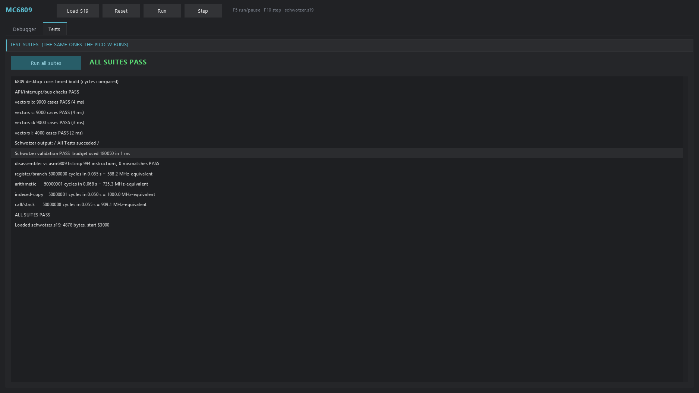

# The 6809 on the desktop (PureBasic x64, Neon Arcade Display Engine)

The same core as the Pico one, for Windows: `cpu6809.pbi` is generated by
`tools/generate.py` from the very handler list that produces
`src/cpu6809.pico`, and differs only in its dispatch and the target lines
(no register reservation, no SRAM procedures, no assembly). It passes the same
suites the Pico W passes.

| File | What it is |
|---|---|
| `cpu6809.pbi` | The core (generated). The API is the Pico core's, names unchanged — see the main README. `.i` is 64-bit here. |
| `disasm6809.pbi` + `disasm6809_table.pbi` | `CpuDisasm(addr)` → text, length in `CpuDisasmLen`. The table is generated from the core's handler list. |
| `testsuite.pbi` | The board verifier, ported: the vectors (read at run time from `Diagnostics/vectors_*.pmi`), the API/interrupt/bus checks, Schwotzer's program and the disassembler against asm6809's listing (both SKIPPED unless `tools/fetch_schwotzer.ps1` has fetched the program), the benchmark mixes. |
| `verify_console.pb` | Console run of every suite (exit code = failures). |
| `m6809.pb` | The program: loads an S-record (Schwotzer's validation program when fetched, otherwise a built-in greeting), registers and flags, disassembly around PC with click-to-break, a memory view with go-to, the `$FF00` output port, Run/Pause (F5), Step (F10), Reset, Load, the measured speed, and a Tests tab that runs every suite. |
| `dispatch_bench.pb` | The dispatch measurement below. |
| `verify_select.pb` | The real core with a central `Select` instead of labels-as-values (measurement only). |

Build and test everything (PowerShell):

```powershell
powershell -ExecutionPolicy Bypass -File tools\build_desktop.ps1
```

Run: `desktop\bin\m6809.exe [program.s19] [tests] [run] [shot:<file.png>] [--pointer-test <log>]`
from the repository folder. `shot:` draws a few frames, saves the window as a
PNG and exits; `docs/desktop-*.png` were taken that way.

`--pointer-test <log>` checks that the pointer and the controls agree at the
display's scale, without moving the real pointer: the window is driven with
synthetic pointer positions. Each of 12 controls gets four points, just inside its
top-left and bottom-right corners (a press must land) and just right of and below
it (a press must not). The controls include the buttons and tabs at the top and
the last disassembly and log rows at the bottom. The exit code is the number of
failures. At 125%: 48 of 48 points pass, and every point reads back within 0.5 px.
With the engine's CRT pointer warp left on (`UI_UseCRT`, which this program
switches off because it does not draw through the CRT pass), 31 fail.

## Dispatch: which is fastest on the PC (measured)

The C back end of PureBasic 6.41 compiles with GCC, so GCC's labels-as-values
(`goto *table[op]`) is reachable through inline C. Measured on this PC
(`/OPTIMIZER`), 200,000,000 instructions:

| Mechanism | Toy interpreter (`dispatch_bench.pb`) |
|---|---:|
| Procedure-pointer table (prototype call per instruction) | 560 M instr/s |
| Central `Select` (a C `switch`) | 885 M instr/s |
| **Labels-as-values through inline C** | **1,087 M instr/s** |

On the real 6809 core (untimed, 100,000,000 instructions) labels-as-values beat
the central `Select` on every mix: 255 / 255 / 216 / 153 M instr/s against
251 / 230 / 186 / 135 for register-branch / arithmetic / indexed copy /
call-stack. The core uses labels-as-values. A procedure-pointer core was not
built: it cannot share the generated handlers (they `Goto` each other), and
the toy shows it losing by half.

Notes for inline C in PureBasic's C back end: a label `Foo:` in procedure
`Bar` is `ll_bar_foo`, a Protected local `v_name`, a Global `g_name`, and an
array is a struct `a_name` whose data is `a_name.a`.

## Speed

Timed build, cycles per second of wall time: 590–1,050 MHz-equivalent
(register-branch 671, arithmetic 645, indexed copy 1,053, call-stack 917).
Untimed: 157–251 M instructions/s. In the window, with the CPU on its own
thread, Schwotzer's program and its end loop ran at 452 MHz-equivalent.

## Controls

<!-- controls: generated by tools/controls_readme.py from desktop/controls.pbi -->

The machine on the desktop has no keyboard (its one device is the output port at `$FF00`),
so every key is the window's own. The window's Controls tab shows this same table.

| Key | Does |
|---|---|
| F5 | run / pause (also the Run / Pause button) |
| F10 | one instruction (also the Step button) |
| F11 | full screen on / off (also the Full screen button) |
| Esc, in full screen | leaves full screen (in the window Esc does nothing) |
| Click a disassembly line | sets or clears the breakpoint there |
| Mouse wheel | scrolls the memory view and the lists |
| go to $ field | type a hex address, the memory view jumps there |
| Load S19 | loads a program (an S-record file, e.g. from asm6809 -S) |
| Reset | puts the CPU back at the program's start |

<!-- end of controls -->

**Full screen** (the Full screen button, or F11) shows only the machine's screen: what
the program writes to `$FF00`, as an 80 x 25 terminal at 4:3, as large as fits and
centred on the window's own monitor, borderless (the display mode does not change).
The CPU keeps running exactly as in the window. The pointer hides after two idle
seconds. Esc leaves full screen, and the window comes back where it was, at the same
size. `--fullscreen-test <log> [<file.png>]` checks all of this (it covers the monitor
for about five seconds).

## The window




The CPU runs on a worker thread, not in the frame, and the window takes the CPU
lock only for the ~1 ms it draws and for reset/step/load/tests. A flag hands the
lock to a waiting frame: a mutex is not fair, and without the flag the worker
re-took it at once and each frame waited ~380 ms.

The GL context is made current once (by `OpenGLWindow`), never per frame: on this
PC `wglMakeCurrent` costs 8-80 ms a call. With both fixes the window opens in
0.25 s and draws at well over 60 frames a second while the CPU runs at ~410 MHz-equivalent beside it.
